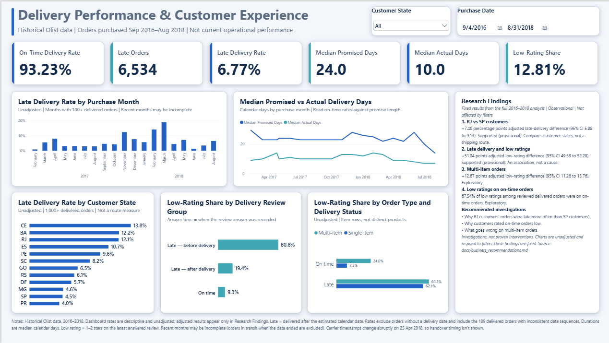
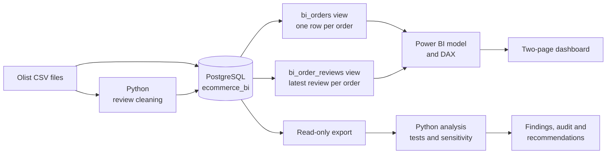

# Olist E-Commerce Delivery & Customer Experience Analytics

An end-to-end BI case study on 99,441 real, anonymised orders from a Brazilian marketplace (2016–2018). Raw CSV files go through Python and PostgreSQL into a two-page Power BI dashboard, backed by a pre-specified statistical analysis, sensitivity testing, a technical audit and evidence-based business recommendations.



**Tools:** Python (pandas, NumPy, SciPy, statsmodels) · PostgreSQL 17 and SQL · DBeaver · Power BI Desktop (PBIP project) · DAX · Git and GitHub

## Contents

- [Business problem](#business-problem)
- [Analytical questions](#analytical-questions)
- [Data pipeline](#data-pipeline)
- [Dashboard](#dashboard)
- [Selected research findings](#selected-research-findings)
- [Business recommendations](#business-recommendations)
- [Validation and limitations](#validation-and-limitations)
- [Challenges and solutions](#challenges-and-solutions)
- [Repository structure](#repository-structure)
- [How to reproduce](#how-to-reproduce)
- [Documentation](#documentation)
- [License and attribution](#license-and-attribution)

## Business problem

Most delivered orders arrived on time (93.23%), but lateness and low ratings aren't evenly spread. Treating them as one delivery problem would point a team at the wrong work. The project asks where delivery and customer-experience issues concentrate, how strong the evidence is, and what a business should investigate next. This is a self-directed portfolio analysis of historical data, not client work and not a view of current operations.

## Analytical questions

1. How much do delivered orders generate, and how reliably do they arrive by the estimated date?
2. Where and when are late deliveries concentrated?
3. How do customer ratings differ between on-time and late orders, and how much of that depends on review timing?
4. Which patterns are strong enough to act on, and which only justify investigation?

Seven questions were written down before the adjusted analysis was run (Class A), alongside clearly labelled exploratory questions (Class B) and descriptive context (Class C). See [docs/methodology.md](docs/methodology.md).

## Data pipeline



| Layer | What it does |
|---|---|
| [python/clean_reviews.py](python/clean_reviews.py) | Flattens multi-line review text so each review is one CSV row; keeps all 99,224 reviews |
| [sql/01_schema.sql](sql/01_schema.sql) | Nine tables, loaded with DBeaver. The tables have no enforced keys, so integrity was checked with queries |
| [sql/02_create_bi_orders.sql](sql/02_create_bi_orders.sql) | `bi_orders`: one row per order. Items and payments are aggregated before joining, so totals aren't inflated |
| [sql/05_create_bi_order_reviews.sql](sql/05_create_bi_order_reviews.sql) | `bi_order_reviews`: the latest answered review per order, using the same rule as the analysis export |
| [sql/04_delivery_analysis.sql](sql/04_delivery_analysis.sql) | Read-only export for the statistical analysis |
| [python/analysis/](python/analysis/) | Logistic models, seller-clustered bootstrap intervals, Holm correction and 16 sensitivity analyses |
| [python/audit/](python/audit/) | Separately written recomputation from the raw CSV files |

## Dashboard

The Power BI project is in [powerbi/](powerbi/) in PBIP format.

**Page 1: Overview.**
- Cards: product sales (R$ 13.22M), delivered orders (96,478), average order value (R$ 137.04), average delivery time (12.5 days) and on-time rate (93.23%).
- Charts: monthly sales and orders, and the top 10 customer states by sales.
- A Key Takeaways panel and a purchase-date slicer.


**Page 2: Delivery & Customer Experience** (shown at the top).
- **Cards:** on-time rate (93.23%), late orders (6,534), late rate (6.77%), median promised and actual delivery time (24 and 10 calendar days), and low-rating share (12.81%).
- **Charts:**
  - late rate by purchase month;
  - promised against actual delivery time;
  - late rate by customer state, for the 12 states with 1,000+ delivered orders;
  - low-rating share by delivery status and review timing;
  - low-rating share by order type.
- **Filters:** customer-state and purchase-date slicers. The review charts are set not to filter the KPI cards.
- **Research Findings panel:** fixed text showing the adjusted research results, labelled as observational and unaffected by filters.

Charts and cards are **descriptive and unadjusted**. The adjusted estimates in the panel come from the statistical analysis and don't change with slicers. Measures are documented in [docs/dax_measures.md](docs/dax_measures.md), and the model in [docs/data_model.md](docs/data_model.md).

## Selected research findings

All results are observational associations, not causal effects. Labels marked provisional are in the [hypothesis log](docs/hypothesis_log.md).

| Finding | Estimate | Status |
|---|---|---|
| Orders delivered to customers in RJ, against SP (customer states, not a shipping route) | Late rate +7.46 points after adjustment (95% CI 5.88 to 9.13) | Supported (provisional), robust |
| Late against on-time orders | Low-rating share +51.04 points after adjustment (95% CI 49.58 to 52.28) | Supported (provisional). Robust as an observational association; review answer timing is an important limitation |
| Multi-item against single-item orders | Low-rating share +12.67 points after adjustment (95% CI 11.26 to 13.76) | Exploratory |
| Low ratings on on-time orders | 67.54% of low ratings among reviewed delivered orders | Exploratory |

The RJ gap is much larger in three high-lateness months (+23.46 points) than in other months (+3.04), but those months were picked from the data.

Some candidate drivers didn't hold up as clear priorities:
- **Seller concentration and category differences** were detectable but below their practical-importance criteria.
- **Freight** met its criterion only narrowly, and the result is sensitive to how it's modelled.
- **Distance** wasn't supported under the fixed comparison.

None of these is ruled out. Details are in [docs/hypothesis_log.md](docs/hypothesis_log.md) and [docs/sensitivity_results.md](docs/sensitivity_results.md).

## Business recommendations

Four recommendations, each with a proportionate next step, KPIs, guardrails and decision criteria, are in [docs/business_recommendations.md](docs/business_recommendations.md):

1. **Investigate late delivery to Rio de Janeiro customers,** starting with orders from São Paulo sellers.
2. **Separate delivery-related low ratings from other customer-experience issues.**
3. **Validate the carrier handover data** before using it to monitor sellers.
4. **Find out what goes wrong on multi-item orders.**

None is ready for rollout from this evidence alone, and no savings, revenue or return figures are estimated.

## Validation and limitations

**Validation:**
- **KPIs:** the eight locked KPIs were reproduced from the raw CSV files.
- **Audit:** an audit recomputed the main estimates with separately written code. It found no error that changes an estimate, interval or label.
- **Review view:** validated in PostgreSQL and checked row by row against the audited export.
- **Power BI measures:** a 49-check DAX query passed in Power BI Desktop.

See [docs/independent_audit.md](docs/independent_audit.md) and [docs/powerbi_validation.md](docs/powerbi_validation.md). The same author built and checked the work, so none of this is an independent review.

**Main limitations:**
- **Observational data with no holdout:** the data was previewed before the plan was written.
- **Review timestamps:** they record when an answer was recorded, not when a customer submitted a rating.
- **Excluded orders:** undelivered orders are outside the analysis.
- **Recent months:** they may be incomplete.
- **Carrier timestamps:** they change abruptly on 25 April 2018.
- **Open audit items:** six remain open.

## Challenges and solutions

| Challenge | Solution |
|---|---|
| **On-time rate was understated.** Estimated dates are stored at midnight, so 1,292 orders delivered on the estimated day counted as late | Compared calendar dates with `INT()`, moving the rate from 91.90% to 93.23% |
| **Undated orders counted as on time.** In DAX, `BLANK <= date` is TRUE, affecting 8 orders | Added an explicit `NOT(ISBLANK())` check, and an explicit missing-answer group in the review timing column |
| **Risk of inflated revenue.** Orders can have several items and payment records | Aggregated items and payments to order level before joining |
| **A daylight-saving discrepancy.** One order appeared to be approved before purchase | Traced it across the CSV, stored values and DBeaver's display, and [documented what is and isn't proven](docs/data_quality_assessment.md#daylight-saving-timestamp-discrepancy) |
| **An abrupt change in carrier timestamps** on 25 April 2018 | Analysed handover timing separately on each side of the change, and kept it off the dashboard |
| **Review timing drove the headline rating gap** | Split late reviews by answer timing, and showed the split on the dashboard |
| **The dashboard needed the same review rule as the analysis** | Built `bi_order_reviews` from the export's ranking rule, and checked it row by row against the audited export |

## Repository structure

```text
olist-ecommerce-analytics/
├── README.md
├── requirements.txt                     pinned Python packages for the analysis
├── data/
│   ├── README.md                        source, download steps, file list
│   ├── raw/                             source CSV files (ignored by Git)
│   └── processed/                       analysis exports and results (ignored by Git)
├── docs/                                methodology, results, audit, recommendations, model, DAX, validation
├── powerbi/
│   ├── Olist_Ecommerce_Dashboard.pbip   open this in Power BI Desktop
│   ├── Olist_Ecommerce_Dashboard.Report/
│   └── Olist_Ecommerce_Dashboard.SemanticModel/
├── python/
│   ├── clean_reviews.py, verify_figures.py, validate_export.py, investigate_date_sequences.py
│   ├── analysis/                        dataset build, Class A and B analysis, descriptive results, sensitivity
│   └── audit/                           independent recomputation and comparison scripts
├── screenshots/
└── sql/
    ├── 01_schema.sql
    ├── 02_create_bi_orders.sql
    ├── 03_data_quality_and_analysis.sql
    ├── 04_delivery_analysis.sql
    └── 05_create_bi_order_reviews.sql
```

## How to reproduce

You'll need Python 3.13, PostgreSQL 17, a SQL client such as DBeaver, and Power BI Desktop.

1. **Get the data.** Download the dataset into `data/raw/`; see [data/README.md](data/README.md).
2. **Clean the reviews.** Run `python python/clean_reviews.py`, which needs only the standard library.
3. **Build the database.**
   - Create a database named `ecommerce_bi` and run `sql/01_schema.sql`.
   - Import the CSV files with DBeaver, using the cleaned reviews file. Set an explicit time zone for the import, as explained in the [daylight-saving note](docs/data_quality_assessment.md#daylight-saving-timestamp-discrepancy).
4. **Create the views.** `sql/01_schema.sql` already includes `bi_orders`, and `sql/02_create_bi_orders.sql` is a readable copy. Then run `sql/05_create_bi_order_reviews.sql`.
5. **Open the dashboard.**
   - Open `powerbi/Olist_Ecommerce_Dashboard.pbip`. It connects to `localhost` / `ecommerce_bi`, so your database must match that server and name, or the source must be changed in Power Query.
   - Choose **Refresh** and enter your own PostgreSQL credentials. Visuals stay empty until then, because the data cache isn't included.
6. **Re-run the analysis (optional).**
   - Create the Python environment in [docs/analysis_plan.md](docs/analysis_plan.md#reproducible-environment).
   - Run the [read-only export](docs/analysis_plan.md#read-only-export).
   - Then run `python/analysis/build_dataset.py`, `class_a.py`, `class_b.py`, `descriptive.py`, `sensitivity_supplement.py` and `sensitivity.py`, in that order. Each script's header gives its arguments.
   - Seeds are fixed. Full-precision p-values can differ slightly between thread counts; see the [audit follow-up](docs/independent_audit.md).

**To check the headline figures** without a database, run `python python/verify_figures.py` after step 1.

## Documentation

| Document | Contents |
|---|---|
| [methodology.md](docs/methodology.md) | Questions, evidence labels, screening criteria, definitions |
| [analysis_plan.md](docs/analysis_plan.md) | Technical plan: models, metric expressions, sensitivity design |
| [data_quality_assessment.md](docs/data_quality_assessment.md) | Data checks, flagged orders, the timestamp discontinuity |
| [hypothesis_log.md](docs/hypothesis_log.md) | All results, including unsupported ones |
| [sensitivity_results.md](docs/sensitivity_results.md) | Robustness of every finding |
| [independent_audit.md](docs/independent_audit.md) | Technical audit, remediation and open items |
| [business_recommendations.md](docs/business_recommendations.md) | Recommendations, KPIs, roadmap, traceability |
| [data_model.md](docs/data_model.md) | Database views, Power BI model, relationships |
| [dax_measures.md](docs/dax_measures.md) | Every measure and calculated column, exactly as saved |
| [powerbi_validation.md](docs/powerbi_validation.md) | SQL, runtime and visual checks of the dashboard |

## License and attribution

**Data:** [Brazilian E-Commerce Public Dataset](https://www.kaggle.com/datasets/olistbr/brazilian-ecommerce) by Olist, licensed under [CC BY-NC-SA 4.0](https://creativecommons.org/licenses/by-nc-sa/4.0/). This project cleaned the review text and aggregated the data. The dataset, and any material adapted from it, remains under that license, which doesn't permit commercial use.

**Code and documentation:** no open-source license is granted, so all rights are reserved.

**Author:** [dana-kulshikova](https://github.com/dana-kulshikova)
