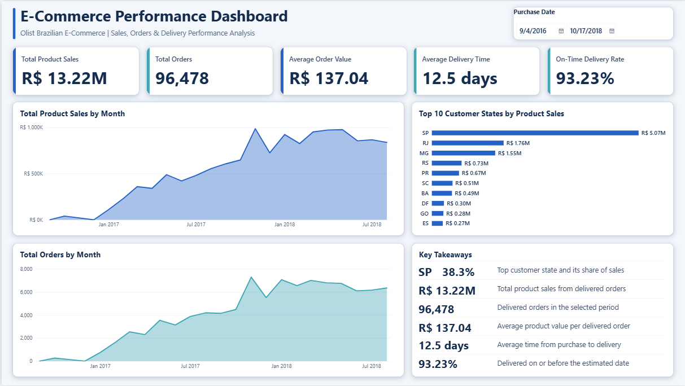
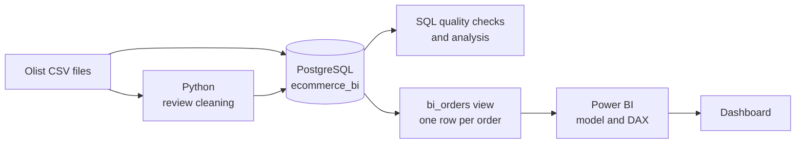
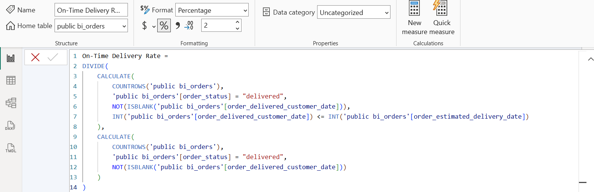
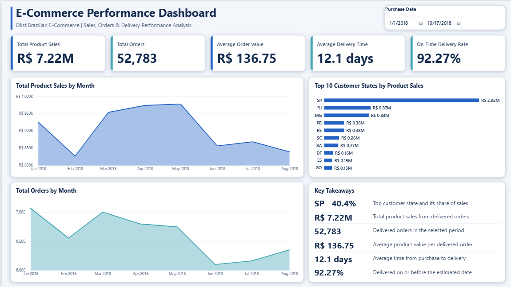
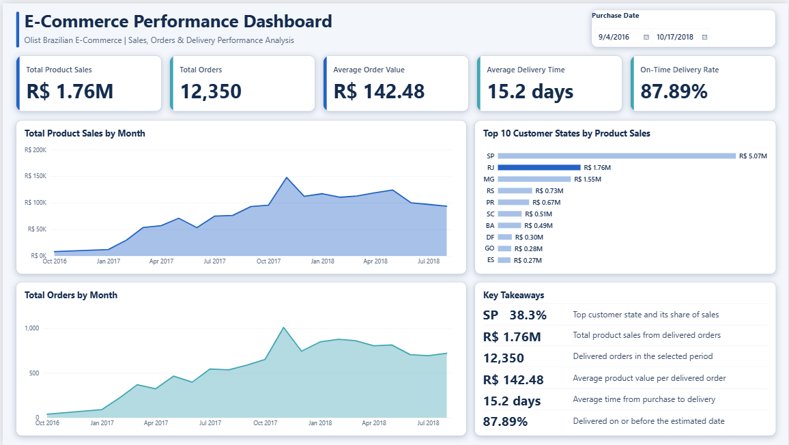

# Olist E-Commerce Performance Analysis

An end-to-end analytics project on 99,441 real, anonymised orders from a Brazilian marketplace, taking raw CSV files through Python and PostgreSQL to an interactive Power BI dashboard.



| Total product sales | Delivered orders | Average order value | Average delivery time | On-time delivery |
|---:|---:|---:|---:|---:|
| **R$ 13.22M** | **96,478** | **R$ 137.04** | **12.5 days** | **93.23%** |

**Tools:** Python (standard library) · PostgreSQL 17 · DBeaver · Power BI Desktop (PBIP project format) · DAX

## Contents

- [Business questions](#business-questions)
- [Workflow](#workflow)
- [Dataset](#dataset)
- [Data quality](#data-quality)
- [Python cleaning](#python-cleaning)
- [PostgreSQL](#postgresql)
- [Power BI model and DAX](#power-bi-model-and-dax)
- [Dashboard](#dashboard)
- [Key insights](#key-insights)
- [Challenges and solutions](#challenges-and-solutions)
- [Limitations](#limitations)
- [Repository structure](#repository-structure)
- [How to reproduce](#how-to-reproduce)
- [License and attribution](#license-and-attribution)

## Business questions

This is a self-directed portfolio analysis, not client work. It sets out to answer the questions an e-commerce team would ask about sales, orders and delivery:

1. How much do delivered orders generate, and what is a typical order worth?
2. How have sales and order volumes changed over time?
3. Which customer states drive sales?
4. How long does delivery take, and how reliably does it meet the estimated date?
5. Can the source data support these answers, and where are its limits?

## Workflow



## Dataset

The [Brazilian E-Commerce Public Dataset by Olist](https://www.kaggle.com/datasets/olistbr/brazilian-ecommerce) contains commercial data that Olist has anonymised. Purchases run from September 2016 to October 2018 across nine related files.

| Main tables | Rows |
|---|---:|
| Orders | 99,441 |
| Order items | 112,650 |
| Payments | 103,886 |
| Reviews | 99,224 |
| Customers | 99,441 |

The data isn't stored in this repository. See [data/README.md](data/README.md) for the full file list and download steps.

## Data quality

I checked completeness, uniqueness, references, date logic and financial reconciliation before building any KPI. Original records were kept, and exceptions are handled by explicit rules.

| Finding | Result | Handling |
|---|---|---|
| Duplicate order IDs and broken references | None found | Order-level grain confirmed |
| Carrier handover before purchase | 166 orders | Flagged by `valid_delivery_dates` |
| Delivery before carrier handover | 23 orders | Flagged by `valid_delivery_dates` |
| Delivered with no delivery date | 8 orders | Excluded from delivery KPIs |
| Payments vs items plus freight | R$ 165,318.88 difference, of which R$ 162,591.95 is on 775 orders with no items | Documented, not adjusted |
| Orders with several payment records | 2,961 orders, up to 29 records | Aggregated before joining |
| Approval before purchase | 0 in the CSV, 1 in PostgreSQL | Traced to a daylight-saving discrepancy |

The full results are in [docs/data_quality_assessment.md](docs/data_quality_assessment.md).

## Python cleaning

[python/clean_reviews.py](python/clean_reviews.py) prepares the reviews file for import. It flattens multi-line text so each review is one CSV row, checks the column count, and validates scores and timestamps.

**Result:** all 99,224 reviews were kept, and 3,852 text fields were flattened. No invalid scores or dates were found.

The cleaned reviews are in the database, but they don't feed the dashboard's KPIs.

## PostgreSQL

[sql/01_schema.sql](sql/01_schema.sql) holds the structure of the nine tables, which have no primary keys, foreign keys or indexes. Integrity was checked with queries rather than enforced by the database.

The dashboard reads a single view, [`bi_orders`](sql/02_create_bi_orders.sql), with one row per order:

```sql
WITH items AS (
    SELECT order_id, SUM(price) AS product_sales, ...
    FROM public.olist_order_items_dataset
    GROUP BY order_id
),
payments AS (
    SELECT order_id, SUM(payment_value) AS payment_total
    FROM public.olist_order_payments_dataset
    GROUP BY order_id
)
SELECT ...
FROM public.olist_orders_dataset o
LEFT JOIN public.olist_customers_dataset c ON o.customer_id = c.customer_id
LEFT JOIN items i ON o.order_id = i.order_id
LEFT JOIN payments p ON o.order_id = p.order_id;
```

Aggregating items and payments first means an order with several of either can't inflate totals. Left joins keep every order, including those with no items.

[sql/03_data_quality_and_analysis.sql](sql/03_data_quality_and_analysis.sql) holds 17 read-only queries for quality checks, business analysis and KPI validation.

## Power BI model and DAX

The model imports `bi_orders` as one order-level table, with Power BI's automatic date tables for time analysis. See [docs/data_model.md](docs/data_model.md) for the reasoning.

| Measure | Definition |
|---|---|
| Total Product Sales | Item prices on delivered orders, excluding freight |
| Total Orders | Distinct delivered orders |
| Average Order Value | Total Product Sales ÷ Total Orders |
| Average Delivery Time | Average days from purchase to delivery, for delivered orders with valid dates |
| On-Time Delivery Rate | Share of delivered orders arriving on or before the estimated date |
| Top State by Sales | State with the highest sales in the current selection |
| Top State Sales Share | That state's share of sales in the current selection |

The exact DAX is in [docs/dax_measures.md](docs/dax_measures.md). This is the corrected on-time measure:



## Dashboard

The dashboard is a single 16:9 page with:

- A **Purchase Date slicer** that filters the whole page
- **Five KPI cards** for sales, orders, order value, delivery time and on-time rate
- **Monthly area charts** for product sales and orders
- A **Top 10 customer states** bar chart that cross-filters the page when a state is clicked
- A **Key Takeaways panel** with live figures from the measures and no hard-coded numbers

| Filtered to 2018 | Rio de Janeiro selected |
|---|---|
|  |  |

In the Key Takeaways panel, the top-state row follows the date slicer but deliberately ignores state clicks. Otherwise, clicking any state would simply show that state with a 100% share.

## Key insights

All figures cover delivered orders and can be reproduced with [python/verify_figures.py](python/verify_figures.py). They describe what happened: this data doesn't explain why.

- **Sales are concentrated.** São Paulo (SP) accounts for 38.33% of product sales, the top three states for 63.38% and the top ten for 87.91%.
- **SP's share was higher in 2018.** It rose from 35.83% in 2017 to 40.44% in 2018.
- **November 2017 was the peak.** It reached R$ 987,765 and 7,289 orders, 52% above October.
- **2018 sales levelled off.** Monthly sales stayed between R$ 826K and R$ 978K from January to August.
- **Most orders arrive on time, but not everywhere.** The overall on-time rate is 93.23%.
- **Late deliveries vary widely by state.** Among states with at least 1,000 delivered orders, CE (13.76%), BA (12.16%) and RJ (12.11%) have the highest late rates, compared with 4.04% in PR and 4.49% in SP.
- **Rio de Janeiro stands out.** It's the second-largest market, at R$ 1.76M, and also has one of the highest late rates.

## Challenges and solutions

| Challenge | How it was found | Solution |
|---|---|---|
| **On-time rate was understated.** Estimated dates are stored at midnight, so 1,292 orders delivered on the estimated day counted as late. | Investigating the measure's logic | Compared calendar dates using `INT()`, moving the rate from 91.90% to 93.23% |
| **Undated orders counted as on time.** In DAX, `BLANK <= date` is TRUE, affecting 8 orders. | Reconciling the live model against the source CSV | Added an explicit `NOT(ISBLANK())` check |
| **Sales text showed "R$ 13,221,498.11M".** `FORMAT` ignored the scaling commas. | Reviewing the measure's output | Divided by 1,000,000 before formatting |
| **A saved date filter hid data.** It stopped at 1 August 2018, leaving out 6,045 delivered orders and creating a false drop at the end of the charts. | Comparing filtered and unfiltered KPIs | Reset the slicer to the full date range |
| **A daylight-saving discrepancy.** One order appeared to be approved before purchase. | Comparing PostgreSQL results with the CSV | Traced it across the CSV, stored values and DBeaver's display, and [documented what is and isn't proven](docs/data_quality_assessment.md#daylight-saving-timestamp-discrepancy) |
| **Risk of inflated revenue.** Orders can have several items and payment records. | Data quality checks | Aggregated to order level before joining |

## Limitations

- **Delivered orders only.** `Total Orders` and sales exclude other statuses, which make up 3% of orders. Sales also exclude freight.
- **Partial periods.** 2016 is very sparse, and no order purchased after August 2018 is marked delivered.
- **Different delivery filters.** `Average Delivery Time` uses `valid_delivery_dates`, while `On-Time Delivery Rate` includes every delivered order with a delivery date.
- **Late rates by state aren't on the dashboard.** They come from query 14 and the verification script, and the 1,000-order threshold was applied only for this summary.
- **Chart axes rescale when filtered.** Monthly charts don't always start at zero in a filtered view, which can make changes look larger.
- **Simple model.** It uses one table and automatic date tables rather than a star schema.
- **Empty measures.** `Measure` and `Measure 2` remain in the model, unused, because this is an exact copy of the working project.
- **Unused data.** Reviews, products, sellers, geolocation, payments and freight don't feed any KPI.
- **Delivery time calculations differ slightly.** Query 12 uses fractional days, while the DAX measure counts calendar-day boundaries, so their results can differ a little.

## Repository structure

```text
olist-ecommerce-analytics/
├── README.md
├── .gitignore
├── data/
│   ├── README.md                          source, download steps, file list
│   └── raw/                               CSV files go here (ignored by Git)
├── docs/
│   ├── data_model.md
│   ├── data_quality_assessment.md
│   └── dax_measures.md
├── powerbi/
│   ├── Olist_Ecommerce_Dashboard.pbip     open this in Power BI Desktop
│   ├── Olist_Ecommerce_Dashboard.Report/
│   └── Olist_Ecommerce_Dashboard.SemanticModel/
├── python/
│   ├── clean_reviews.py                   the project's review cleaning
│   └── verify_figures.py                  added for publication
├── screenshots/
└── sql/
    ├── 01_schema.sql
    ├── 02_create_bi_orders.sql
    └── 03_data_quality_and_analysis.sql
```

## How to reproduce

You'll need Python 3, PostgreSQL 17, a SQL client such as DBeaver, and Power BI Desktop. The Python scripts have no external dependencies.

1. **Get the data.** Download the dataset and extract it into `data/raw/`.
2. **Clean the reviews.** Run `python python/clean_reviews.py`.
3. **Build the database.** Create a database named `ecommerce_bi` and run `sql/01_schema.sql`.
4. **Import the CSV files** into their matching tables, using the cleaned reviews file. This project used DBeaver's CSV import. Set an explicit time zone for the import, for the reason described in the [daylight-saving note](docs/data_quality_assessment.md#daylight-saving-timestamp-discrepancy).
5. **Check the view.** `sql/01_schema.sql` already creates `bi_orders`, and `sql/02_create_bi_orders.sql` is a readable copy that can safely be re-run.
6. **Open the dashboard.** Open `powerbi/Olist_Ecommerce_Dashboard.pbip`, then choose **Refresh** and enter your own PostgreSQL credentials. Visuals stay empty until the first refresh, because the data cache isn't included.

**To check the figures** without a database, run `python python/verify_figures.py` after step 1.

## License and attribution

**Data:** [Brazilian E-Commerce Public Dataset](https://www.kaggle.com/datasets/olistbr/brazilian-ecommerce) by Olist, licensed under [CC BY-NC-SA 4.0](https://creativecommons.org/licenses/by-nc-sa/4.0/). This project cleaned the review text and aggregated the data. The dataset, and any material adapted from it, remains under that license, which doesn't permit commercial use.

**Code and documentation:** no open-source license is granted, so all rights are reserved.

**Author:** [dana-kulshikova](https://github.com/dana-kulshikova)
