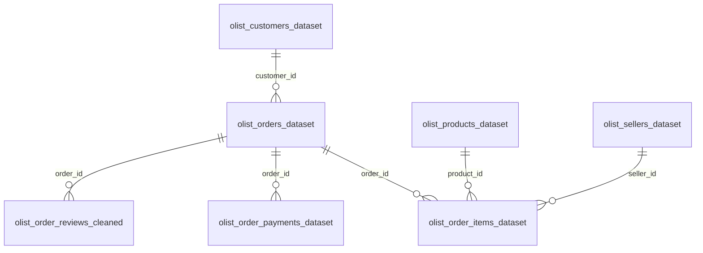

# Data Model

## PostgreSQL

The `ecommerce_bi` database holds nine tables and one view. `sql/01_schema.sql` contains the exported structure.

The tables have no primary keys, foreign keys or indexes. The relationships below are logical and were checked with queries.

`olist_geolocation_dataset` links to customers and sellers by ZIP code prefix, and `product_category_name_translation` links to products by category name. Neither feeds the dashboard.

### The `bi_orders` view

`sql/02_create_bi_orders.sql` builds one row per order, which is what Power BI imports.

- **Items** are summed by order into `product_sales`, `freight_value` and `items_count`.
- **Payments** are summed by order into `payment_total`.
- **Aggregating before joining** stops orders with several items or payments from inflating totals.
- **Left joins** keep all 99,441 orders, including the 775 with no item records, whose sales become 0.
- **`valid_delivery_dates`** is TRUE only when purchase, carrier handover and customer delivery are all present and in order.
- **Order status isn't filtered here.** The Power BI measures apply the delivered filter.

## Power BI

The semantic model is deliberately simple:

| Element | Detail |
|---|---|
| Fact table | `public bi_orders`, with 16 columns at order level |
| Storage mode | Import |
| Power Query | Connects to `ecommerce_bi` and navigates to the view, with no further transformation |
| Date handling | Power BI's automatic date tables, one per date column, each with a relationship to the fact table |
| Measures | Listed in [dax_measures.md](dax_measures.md) |

There's no separate date dimension or star schema. One order-level table was enough for a single-page dashboard, but a dedicated date table would be the first improvement if the model grows.

