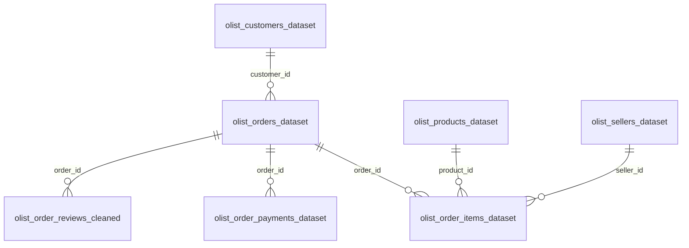
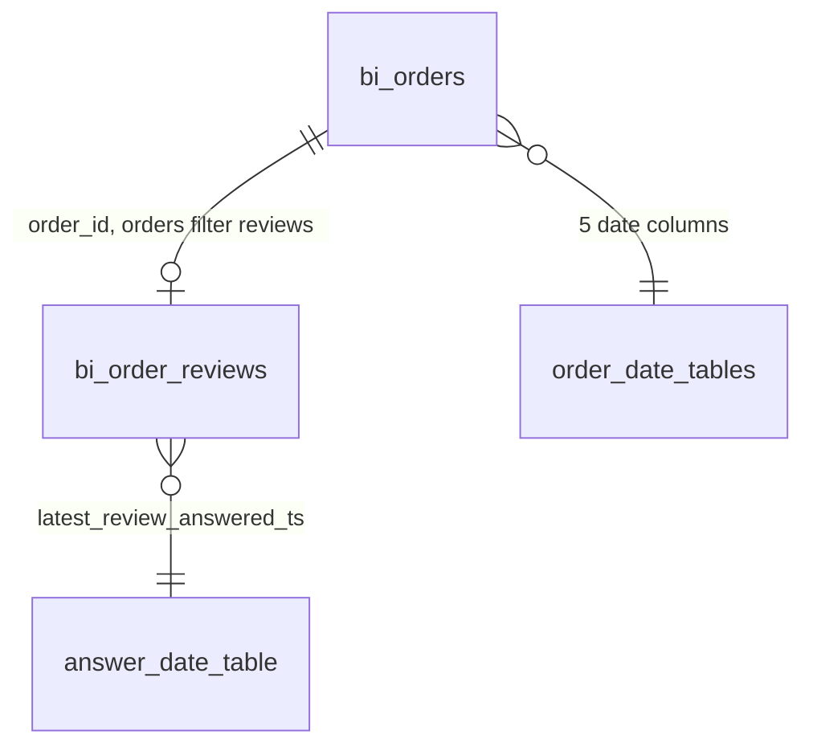
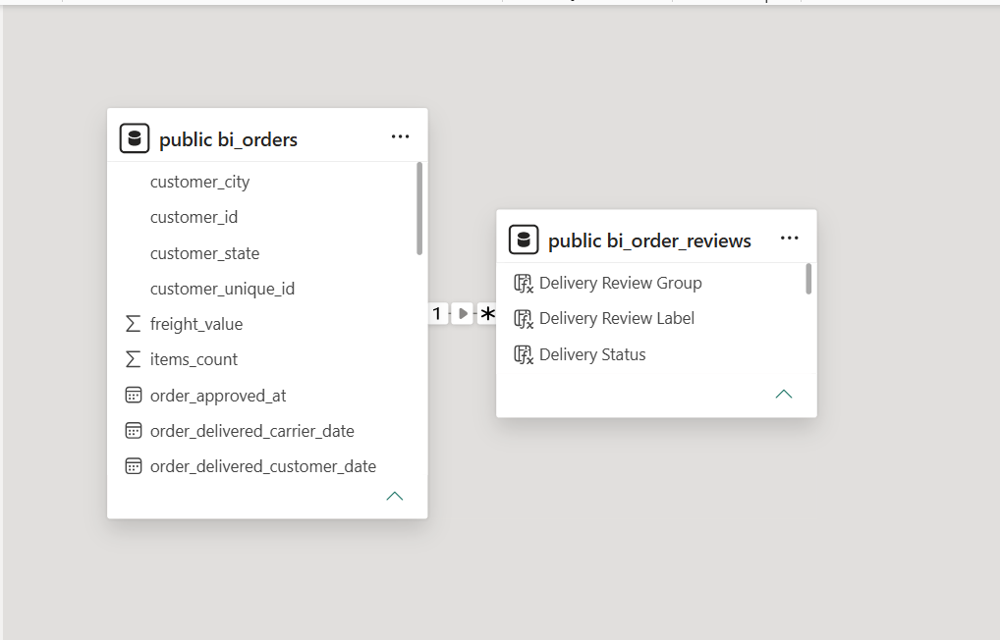

# Data Model

## PostgreSQL

The `ecommerce_bi` database holds nine tables and two views. `sql/01_schema.sql` contains the table structure.

The tables have no primary keys, foreign keys or indexes. The relationships below are logical and were checked with queries.

`olist_geolocation_dataset` links to customers and sellers by ZIP code prefix, and `product_category_name_translation` links to products by category name. Neither feeds the dashboard.

### The `bi_orders` view

[`sql/02_create_bi_orders.sql`](../sql/02_create_bi_orders.sql) builds one row per order (99,441 rows, all statuses), which Power BI imports.

- **Items** are summed by order into `product_sales`, `freight_value` and `items_count` (the number of item rows).
- **Payments** are summed by order into `payment_total`.
- **Aggregating before joining** stops orders with several items or payments from inflating totals.
- **Left joins** keep all 99,441 orders, including the 775 with no item records, whose sales become 0.
- **`valid_delivery_dates`** is TRUE only when purchase, carrier handover and customer delivery are all present and in order.
- **Order status isn't filtered here.** The Power BI measures apply the delivered filter.

### The `bi_order_reviews` view

[`sql/05_create_bi_order_reviews.sql`](../sql/05_create_bi_order_reviews.sql) returns one row per order that has a review (98,673 rows), with `order_id`, `latest_review_score` and `latest_review_answered_ts`.

- **Selection rule:** the same as the analysis export in `sql/04_delivery_analysis.sql`. Each order's reviews are ranked by answer timestamp, then creation date, then review ID, all descending, and the first is kept.
- **Uniqueness:** `ROW_NUMBER() = 1` guarantees one row per order.
- **Missing reviews:** 768 orders have no review, so they have no row here.
- **Validation:** see [powerbi_validation.md](powerbi_validation.md).

## Power BI

| Element | Detail |
|---|---|
| `public bi_orders` | One row per order (99,441), all statuses. 16 imported columns and the order-level measures |
| `public bi_order_reviews` | One row per order with a selected review (98,673). 3 imported columns, 4 calculated columns and the review measures |
| Storage mode | Import for both tables |
| Power Query | Each table connects to `ecommerce_bi` on `localhost` and navigates to its view, with no further transformation |
| Date handling | Power BI's automatic date tables, one per date column, each with its own relationship |
| Measures | Listed in [dax_measures.md](dax_measures.md) |

In Power BI the tables are named `public bi_orders` and `public bi_order_reviews`. Each order has at most one review row.

### Relationships

| From (many side) | To (one side) | Cardinality | Filter direction | Active |
|---|---|---|---|---|
| `public bi_order_reviews[order_id]` | `public bi_orders[order_id]` | Many to one | Single: orders filter reviews | Yes |
| Each of the 5 `bi_orders` date columns | Its own automatic date table | Many to one | Single | Yes |
| `public bi_order_reviews[latest_review_answered_ts]` | Its own automatic date table, added when the view was imported | Many to one | Single | Yes |

The review relationship is declared many-to-one even though each order has at most one review row. With a single direction, review-side selections can't change delivery or sales measures, which would be possible with a one-to-one relationship because those filter in both directions. Uniqueness is guaranteed by the view and checked by the hidden Review Key Check measure.

### Filtering behaviour

- **Slicers on `bi_orders`** (purchase date, customer state) filter both tables.
- **Review columns** (Delivery Review Group, its display label, Order Type, Delivery Status) affect review measures only.
- **Interactions:** the two review charts on the second page are set not to filter other visuals, so the delivery cards always show one consistent population.
- **Purchase month:** monthly charts use the automatic date hierarchy of `order_purchase_timestamp`, reduced to Year and Month in each visual. This needs no change to the model.

### Known limitations

- **No star schema.** The model has two order-level tables and automatic date tables, rather than a dedicated date dimension. The automatic tables can't put purchase and delivery dates on one axis, and the dashboard doesn't need that.
- **No seller or shipping fields** are imported, so seller and route views aren't possible in Power BI.
- **Review timestamps** record when the answer was recorded, not when a customer formed or submitted a rating.
- **Refresh** needs the local PostgreSQL database and both views. Credentials are stored by Power BI Desktop, not in the project files.
- **Two empty measures**, `Measure` and `Measure 2`, remain from the original model and aren't used.

The model view screenshot shows the original single-table model, before the review table was added.
